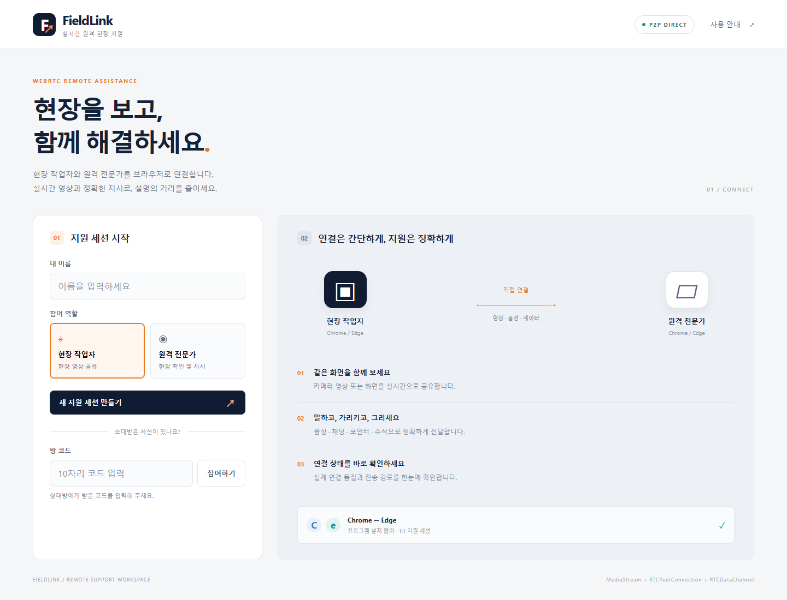
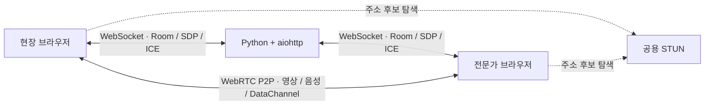

# FieldLink · WebRTC P2P 원격 현장 지원

**백엔드 Python + aiohttp / 프론트엔드 HTML + CSS + JavaScript / 통신 WebSocket + WebRTC**

브라우저에서 현장 작업자와 원격 전문가를 1:1로 연결합니다. Python 서버는 웹 화면과 방 관리, 연결 정보 교환을 담당합니다. 영상·음성·채팅·포인터·주석은 브라우저 사이의 WebRTC P2P로 전송합니다.



## 빠른 시작

서버 PC에는 **Python 3.11 이상**, 화면을 보낼 기기에는 **데스크톱 Chrome 또는 Edge**가 필요합니다. 다른 클라이언트 기기에는 Python을 설치하지 않아도 됩니다.

### Windows

```powershell
git clone https://github.com/yoonmojeon/pbl2_webrtc.git
cd pbl2_webrtc
.\start.cmd
```

Git을 사용하지 않으면 **Code → Download ZIP**으로 내려받아 압축을 풀고 `start.cmd`를 더블클릭합니다. 첫 실행에는 프로젝트 전용 `.venv`를 만들고 aiohttp 의존성을 설치하므로 인터넷 연결이 필요합니다.

서버가 실행되면 실제 Chrome 또는 Edge 주소창에 [http://localhost:3000](http://localhost:3000)을 입력합니다. 서버를 종료하려면 실행한 터미널에서 `Ctrl+C`를 누릅니다.

### macOS / Linux

```sh
git clone https://github.com/yoonmojeon/pbl2_webrtc.git
cd pbl2_webrtc
sh start.sh
```

운영체제마다 가상환경을 새로 만듭니다. macOS·Linux 실행 스크립트는 제공하지만 실기기 실행은 자동 검증 범위에 포함하지 않았습니다.

## 데스크톱 화면을 스마트폰·노트북에서 보기

1. 서버 PC의 Chrome 또는 Edge에서 **localhost:3000**을 엽니다.
2. 이름 입력 → **새 지원 세션 만들기**를 누릅니다.
3. 위에 표시된 **10자리 방 코드**를 확인합니다.
4. **화면 공유** → 탭·창·전체 화면 선택 → 브라우저의 **공유**를 누릅니다.
5. 수신할 스마트폰이나 노트북을 같은 공유기의 Wi-Fi 또는 LAN에 연결합니다.
6. 수신 기기의 WebRTC 지원 브라우저에서 **서버 PC의 내부 IP:3000**으로 접속합니다. [내부 IP 확인 방법](docs/NETWORKING.md#서버-pc의-내부-ip-확인)을 참고합니다.
7. 수신 기기에 이름과 같은 방 코드를 입력하고 **참여하기**를 누릅니다.

수신 기기에는 localhost 대신 서버 PC의 내부 IP를 입력합니다. 일반 HTTP 내부 IP 주소에서는 자동으로 보기 모드가 되어 `view=0/1`을 직접 붙일 필요가 없습니다.

영상이 도착했지만 멈춰 있으면 **영상 재생**을 누릅니다. 목소리도 전달하려면 데스크톱에서 **마이크 켜기**, 수신 기기에서 **소리 켜기**를 누릅니다. 시스템 소리는 전송하지 않습니다.

같은 PC의 Chrome과 Edge를 모두 localhost로 열면 양방향 영상·음성을 시험할 수 있습니다. 다른 기기의 카메라·마이크 송신에는 신뢰되는 HTTPS와 해당 브라우저의 API 지원이 필요합니다.

## 기술 스택

| 영역 | 기술 | 역할 |
| --- | --- | --- |
| 백엔드 | Python 3.11+ · aiohttp 3.14.5 · asyncio | HTTP 화면 제공, 방 관리, 비동기 WebSocket |
| 프론트엔드 | HTML · CSS · JavaScript ES Modules | 반응형 UI, 미디어 제어 |
| 신호 교환 | WebSocket · JSON · SDP · ICE | 참여자 연결, 미디어 정보·경로 후보 교환 |
| 미디어 | MediaStream · RTCPeerConnection | 카메라·마이크·화면 획득과 P2P 전송 |
| 부가 데이터 | RTCDataChannel | 채팅·포인터·주석·장치 상태 |
| NAT 대응 | ICE · 공용 Google STUN | 직접 연결 경로 탐색 |
| 주석 | Canvas · Pointer Events · 정규화 좌표 | 크기가 다른 영상에서 같은 위치 표시 |
| 품질 | getStats · RTCRtpSender.setParameters | 실제 통계와 송신 상한 조절 |
| 검증 | unittest · Python Playwright 1.58.0 | 서버 및 실제 Chrome·Edge 시험 |

앱 실행 의존성은 [requirements.txt](requirements.txt), 브라우저 검증 의존성은 [requirements-dev.txt](requirements-dev.txt)에 고정했습니다. 앱 실행에 Node.js 빌드 도구는 필요하지 않습니다.

## 연결 구조



STUN은 주소 후보 탐색에 사용합니다. 현재 구성에는 TURN 미디어 릴레이와 SFU를 포함하지 않습니다. 같은 LAN에서도 신호 서버는 필요하며, 다른 회선에서는 NAT·방화벽 조건에 따라 직접 연결이 실패할 수 있습니다.

## 구현 범위

- 무작위 10자리 방 코드, 방당 최대 2명, 퇴장·재입장
- Perfect Negotiation, SDP/ICE 교환, 카메라·화면 전환
- 마이크, P2P 채팅, 터치 포인터, 자유 그리기·지우기
- 영상과 주석을 합성한 PNG 캡처
- RTT·전송률·FPS·해상도·수신 손실·지터·연결 수립 시간 표시
- 송신 품질 프리셋과 RTT/손실에 따른 상한 조절
- ICE restart, WebSocket 재접속, 진단 JSON 다운로드
- HTTP 보기 모드와 데스크톱 화면 공유 전환

현재는 **기본 아키텍처와 동작 원리를 검증하는 PoC**입니다. 다른 NAT·LTE/5G 환경의 성공, 다자간 연결, 센서 연동, 로그인, 영구 저장, 분산 운영은 구현·검증 범위에 포함하지 않습니다. 실기기 확인 사례로는 사용자가 직접 확인한 데스크톱→아이폰 화면 수신 성공이 있으며, 자동 검증과 구분해 기록했습니다.

## 문서

| 문서 | 내용 |
| --- | --- |
| [사용 매뉴얼](docs/USER_GUIDE.md) | 설치, 화면 공유, 방 입장, 버튼, 문제 해결 |
| [기술 스택](docs/TECH_STACK.md) | 기술별 역할, 연결 과정, 코드 위치, 선택 이유 |
| [아키텍처](docs/ARCHITECTURE.md) | 구성·시퀀스 다이어그램, 프로토콜, 품질·복구 설계 |
| [네트워크·설정](docs/NETWORKING.md) | LAN 주소, 보기 모드, HTTPS, STUN/NAT, 설정 우선순위 |
| [검증 기록](docs/VALIDATION.md) | 실행 명령, 결과, 실기기 확인과 미검증 범위 |

## 검증 실행

실행 환경을 준비한 뒤 서버를 검증합니다.

```powershell
.\.venv\Scripts\python.exe -m unittest discover -s tests -p "test_*.py" -v
```

Windows에 설치된 실제 Chrome·Edge를 이용하는 브라우저 검증은 다음과 같습니다.

```powershell
.\.venv\Scripts\python.exe -m pip install -r requirements-dev.txt
.\.venv\Scripts\python.exe tests/browser.py
.\.venv\Scripts\python.exe tests/viewer.py
.\.venv\Scripts\python.exe tests/http_compat.py
.\.venv\Scripts\python.exe tests/layout.py
```

테스트는 별도 임의 포트의 서버와 가상 미디어를 사용합니다. 결과는 로컬 `test-results/`에 생성합니다. 사용 중인 3000번 서버나 사용자의 실제 화면·카메라는 테스트 대상으로 사용하지 않습니다.

## 프로젝트 구조

```text
pbl2_webrtc/
├── server.py                 # aiohttp HTTP(S)/WebSocket 서버
├── run.py                    # 가상환경·의존성 준비 및 실행
├── start.cmd / start.sh      # 운영체제별 실행
├── requirements*.txt         # 실행 / 검증 의존성
├── config.example.toml       # 서버 설정 예시
├── public/
│   ├── index.html / style.css
│   ├── app.js                # 미디어·UI·채팅·주석·캡처
│   ├── rtc.js                # WebRTC 협상·통계·복구
│   ├── id.js                 # HTTP 호환 식별자 생성
│   └── architecture.html     # 브라우저에서 보는 설계 설명
├── tests/                    # 서버·브라우저 검증
└── docs/                     # 매뉴얼·기술 스택·설계·검증
```

`config.toml`, 인증서와 개인 키, `.venv`, 로그, 실행 중 방 정보는 저장소에 포함하지 않습니다. 기본 설정으로 바로 실행할 수 있습니다.
