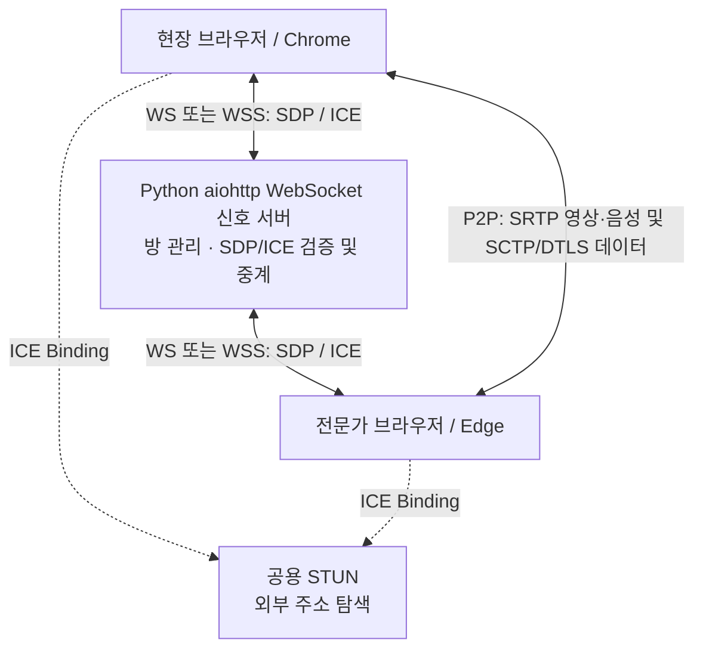
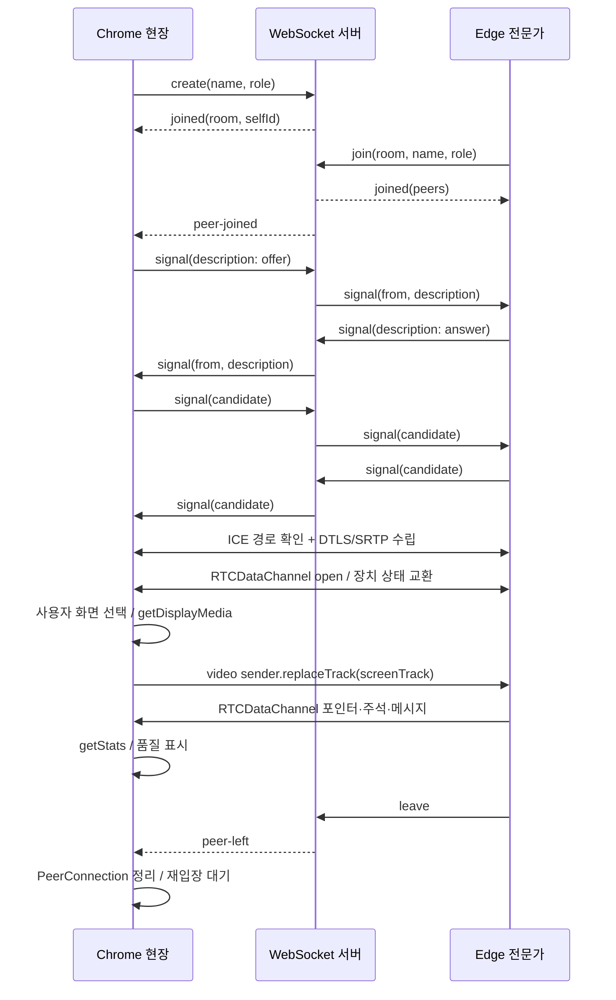

# WebRTC 기반 실시간 원격 현장 지원 시스템 설계

## 1. 문제와 범위

사진·전화만으로 현장을 설명하면 작업자와 전문가가 동일한 위치를 보고 있는지 확인하기 어렵습니다. 이 시스템은 브라우저에서 실시간 영상을 공유하고 같은 영상 위에 지시를 표시합니다.

기본 범위는 현장 작업자 1명과 원격 전문가 1명의 Chrome↔Edge 연결입니다. 카메라 미연결 시 화면 공유를 사용하며 양쪽 모두 영상과 음성을 보낼 수 있습니다. 별도 네이티브 앱이나 WebRTC 미디어 서버를 설치하지 않습니다. Python aiohttp 신호 서버 실행은 필요합니다.

## 2. 아키텍처

- **브라우저**: MediaStream으로 카메라·마이크·화면을 획득하고 RTCPeerConnection으로 직접 전송합니다. 미디어는 서버에 업로드하거나 저장하지 않습니다.
- **신호 서버**: 방 코드 생성, 최대 인원 확인, 상대 참여자 식별, SDP Offer/Answer와 ICE Candidate를 중계합니다. 미디어 코덱 처리나 영상 중계는 하지 않습니다.
- **STUN**: NAT 바깥에 보이는 주소 후보를 알아내는 데 사용합니다. 미디어를 중계하지 않습니다. 같은 LAN에서는 host candidate만으로 연결될 수 있습니다.
- **RTCDataChannel**: 채팅, 포인터, 주석, 미디어 장치 상태를 전송합니다. 하나의 ordered 채널(id 0)을 양쪽이 negotiated 방식으로 생성합니다.
- **TURN/SFU**: 직접 P2P 요구에 따라 사용하지 않습니다. 직접 연결이 차단된 망을 우회해 성공했다고 표시하지 않습니다.

## 3. 연결·공유·종료 시퀀스

실제 구현은 두 브라우저가 동시에 offer를 만들 수 있으므로 Perfect Negotiation을 사용합니다. peer ID의 정렬 순서로 polite/impolite를 결정하고, polite 쪽은 충돌한 offer를 rollback하고 상대 offer를 수용합니다. impolite 쪽은 충돌 offer와 연결된 ICE를 무시합니다. 신호 수신 처리를 직렬화하고 remote description 설정 전의 ICE를 큐에 보관해 순서 경합을 줄입니다.

## 4. 신호 프로토콜과 세션 관리

| 방향 | type | 주요 필드 | 의미 |
| --- | --- | --- | --- |
| C→S | create | name, role, requestId | 새 방 생성 |
| C→S | join | room, name, role, requestId | 기존 방 입장 |
| S→C | welcome | selfId | 소켓 ID |
| S→C | joined | room, selfId, peers, requestId | 입장 완료 |
| S→C | peer-joined | peer(id,name,role) | 상대 입장 |
| C→S | signal | target, payload(description 또는 candidate) | 신호 중계 요청 |
| S→C | signal | from, payload | 검증된 상대 신호 |
| C→S | leave | 없음 | 명시적 퇴장 |
| S→C | peer-left | peerId | 상대 퇴장·소켓 종료 |
| S→C | error | code, message, requestId | 처리 실패 |

방 상태는 Python dict에 저장하며, 방 코드는 secrets 모듈의 암호학적 난수 10자(32진수, 약 50비트)입니다. 방은 최대 2명이며 신호 target은 동일한 방의 다른 멤버여야 합니다. 한 소켓은 한 방에만 참여합니다. 클라이언트가 보낸 from 값은 사용하지 않고 서버가 실제 소켓 ID를 삽입합니다. 소켓은 aiohttp의 20초 heartbeat로 유휴 연결의 생존을 확인하고, 빈 방은 5분 뒤 정리합니다. 서버 재시작 시 방 정보는 사라집니다.

JSON 형식·신호 필드·크기를 검증하고, 소켓당 10초에 400개 메시지를 초과하면 종료합니다. 전체 방 500개, 클라이언트 1000개 상한을 둡니다. 이는 프로토타입의 자원 한도이며 분산 서비스용 admission control은 별도 설계 대상입니다.

## 5. 미디어와 부가 데이터 선택 근거

| 선택 | 근거 | 한계·대안 |
| --- | --- | --- |
| WebRTC 브라우저 API | Chrome·Edge가 미디어·암호화·혼잡 제어를 제공 | 네트워크별 ICE 경로 검증 필요 |
| Python + aiohttp | asyncio 이벤트 루프에서 HTTP·WebSocket과 방 상태를 함께 관리 | 방 상태는 단일 프로세스 메모리 |
| P2P + STUN | 미디어 서버 트래픽 없이 1:1 직접 전송 | 대칭 NAT·UDP 차단 시 TURN 없이 실패 가능 |
| 오디오/비디오 transceiver 사전 생성 | 미디어 권한 없이 데이터 연결부터 수립 가능 | 실제 권한은 미디어 버튼 클릭 시 요청 |
| replaceTrack | 카메라↔화면 전환 시 연결과 데이터 채널 유지 | 동시에 보내는 영상은 1개 |
| ordered DataChannel | 주석 시작·점·지우기와 채팅의 순서 보장 | 대량 데이터가 포인터 지연에 영향을 줄 수 있음 |
| 정규화 좌표 | 서로 다른 창·영상 크기에도 같은 위치 표시 | 3D 물체 추적·AR 고정은 아님 |

포인터·주석의 좌표는 영상의 표시 영역(object-fit: contain)을 기준으로 0~1로 정규화합니다. 검은 여백은 좌표 영역에서 제외합니다. 화면 변경마다 source revision을 증가시키고 `영상 소유자 ID:revision`을 붙여 이전 카메라의 주석이 새 공유 화면에 나타나지 않게 합니다. 미디어 상태가 바뀌면 상대에게 source/audio/video 상태를 전송합니다.

데이터 메시지는 chat, status, pointer, stroke, clear로 제한합니다. 문자열 크기와 좌표·색상·stroke ID를 검증하며, HTML 대신 textContent로 표시합니다. 포인터·드로잉 전송을 약 30ms 간격으로 제한하고 채널 버퍼가 1MiB를 넘으면 전송하지 않습니다. 주석은 최근 영상 4개·영상당 150개 획·획당 약 1500개 점, 채팅은 화면에 최근 200개만 유지합니다.

외부 센서·원격 기기 제어는 확장 과제입니다. 현재 status는 실제 공유 소스와 마이크 상태를 나타내며 가상 센서값을 생성하지 않습니다.

## 6. 품질 측정과 제어

1. 연결 중 1.5초마다 `getStats()`를 호출합니다.
2. transport의 selectedCandidatePairId로 실제 선택 경로를 확인합니다. 주소 자체는 화면·진단 파일에 노출하지 않습니다.
3. RTT는 candidate-pair.currentRoundTripTime, FPS·해상도는 영상 RTP 통계, 전송률은 연속 bytes 차이 / timestamp 차이로 계산합니다.
4. 수신 영상이 있으면 수신 지표를, 없고 송신 영상만 있으면 송신 지표를 표시합니다. 수신 영상 손실률은 해당 구간의 lost / (received + lost), 지터는 inbound-rtp.jitter입니다. 측정할 수 없는 값은 `—`로 표시합니다.
5. 첫 connected까지 걸린 시간을 연결 수립 시간으로 기록합니다. RTT는 네트워크 왕복 시간이며 영상의 전체 종단 간 지연을 의미하지 않습니다.

| 상한 프리셋 | maxBitrate | maxFramerate | scaleResolutionDownBy |
| --- | --- | --- | --- |
| 높음 | 2.5 Mbps | 30 | 1 |
| 보통 | 1 Mbps | 24 | 1.5 |
| 낮음 | 350 Kbps | 15 | 2 |

자동 모드는 RTT >350ms 또는 측정 손실 >8%일 때 낮음, RTT >180ms 또는 손실 >3%일 때 보통, 그 외 높음을 선택합니다. 조절 간격은 최소 9초입니다. 브라우저의 기본 혼잡 제어는 계속 동작하며 이 로직은 인코더의 상한만 설정합니다. 송신측만 사용하는 세션에서는 수신 영상 손실 지표가 없을 수 있으므로 정교한 혼잡 제어 검증을 대체하지 않습니다.

## 7. 장애·보안·확장

- **권한 거부·장치 없음**: 오류 종류를 안내하고 카메라 대신 화면 공유를 사용할 수 있습니다. 사용자 클릭으로만 화면 선택 창을 엽니다.
- **미디어 정지**: 브라우저의 공유 중지 이벤트로 트랙을 해제하고 상대 UI도 업데이트합니다. 마이크·카메라를 자동으로 켜지 않습니다.
- **ICE disconnected/failed**: 유예 후 최대 3회 자동 restartIce를 시도합니다. 수동 재시도도 제공합니다. 실패 원인을 숨기지 않습니다.
- **신호 소켓 단절**: 1초부터 30초까지 지수 backoff로 최대 8회 재접속합니다. 기존 P2P는 가능한 동안 유지하고 재입장 후 새 peer ID로 연결을 재수립합니다.
- **서버 재시작·방 소멸**: 새 방 생성이 필요하다고 안내합니다. 영속 저장을 구현한 것처럼 처리하지 않습니다.
- **개발/운영 전송**: 같은 공유기 시험에서는 데스크톱이 localhost에서 화면을 보내고 다른 기기가 HTTP 내부 IP로 수신할 수 있습니다. HTTP 수신 기기는 자동으로 보기 모드가 되어 미디어 캡처를 요청하지 않습니다. 다른 기기의 카메라·마이크 송신에는 신뢰되는 HTTPS가 필요하며 운영 배포는 HTTPS/WSS를 사용합니다. WebRTC 미디어와 데이터는 브라우저의 암호화된 전송을 사용합니다.
- **접근**: 방 코드는 초대 비밀값 역할이며 별도 사용자 인증은 없습니다. HTTP 응답에 no-referrer, CSP, frame-ancestors, nosniff를 설정합니다. 신호 소켓은 동일 origin 또는 명시된 allowlist만 받습니다. 실제 배포 서비스에는 사용자 인증·방 접근 권한·세션 감사 정책을 추가해야 합니다.
- **개인정보**: 서버는 영상·음성·채팅을 저장하지 않습니다. 캡처는 사용자가 선택한 로컬 파일로 저장합니다. 진단 export는 최근 300개 이벤트와 최대 240개 통계를 포함하며 SDP, IP, 채팅 본문, 방 코드, 미디어를 제외합니다.
- **확장**: 다중 Python 서버 인스턴스에는 공유 Room 상태와 Pub/Sub, sticky routing 등을 설계해야 합니다. 다자간 영상은 full mesh의 송신 부하가 증가하므로 SFU가 대안입니다. 이는 현재 1:1 P2P 범위 밖입니다.

## 8. 공식 기술 근거

- [W3C WebRTC: PeerConnection, Perfect Negotiation, restartIce, getStats](https://www.w3.org/TR/webrtc/)
- [W3C Screen Capture](https://www.w3.org/TR/screen-capture/)
- [MDN getDisplayMedia: secure context와 사용자 동작 요구](https://developer.mozilla.org/en-US/docs/Web/API/MediaDevices/getDisplayMedia)

이 문서는 제공된 PDF의 설계·품질 고려 항목과 PPT의 1:1 WebSocket·STUN·Chrome↔Edge PoC 범위를 실제 구현과 연결한 결과입니다.

## 9. Python 백엔드 구성

`server.py`의 `create_app()`이 aiohttp Application을 생성합니다. HTTP 라우트와 WebSocket 라우트를 같은 이벤트 루프에서 처리합니다. async/await를 사용해 네트워크 송수신을 기다리는 동안 다른 연결을 처리하고, 방 인원 변경은 await 전에 완료해 동시 입장에서도 최대 2명을 유지합니다.

정적 파일 읽기는 asyncio.to_thread로 실행합니다. cleanup_ctx는 빈 방 정리 작업을 관리하고 on_shutdown은 열린 WebSocket을 닫습니다. Settings dataclass와 TOML·환경변수·CLI로 설정을 분리하며, HTTPS는 Python ssl.SSLContext와 aiohttp로 지원합니다.

[Python aiohttp 서버 공식 문서](https://docs.aiohttp.org/en/stable/web_reference.html) · [aiohttp 테스트 도구](https://docs.aiohttp.org/en/stable/testing.html)
