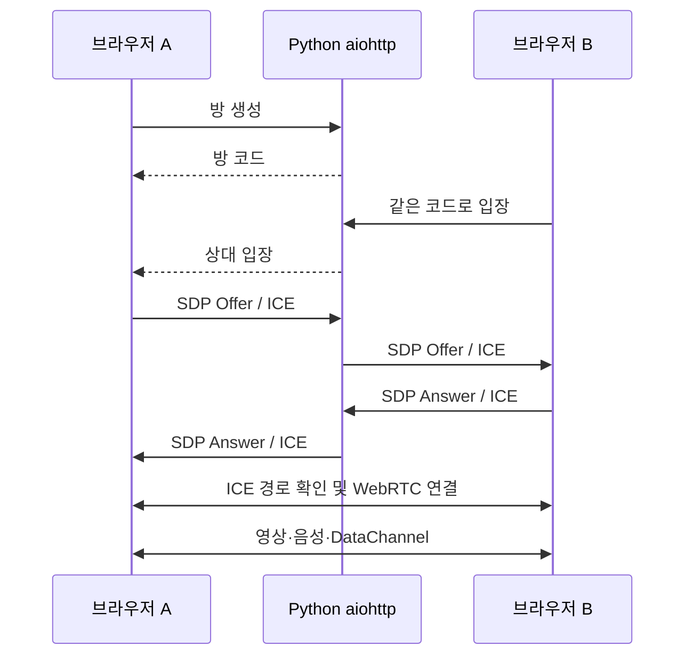

# 기술 스택과 구현 역할

[README](../README.md) · [아키텍처](ARCHITECTURE.md) · [검증 기록](VALIDATION.md)

## 구성과 코드 위치

| 영역 | 기술 | 구현 위치 |
| --- | --- | --- |
| 웹·신호 서버 | Python 3.11+ · aiohttp 3.14.5 · asyncio | [server.py](../server.py) |
| 실행 준비 | Python venv · subprocess | [run.py](../run.py), [start.cmd](../start.cmd), [start.sh](../start.sh) |
| 화면 | HTML · CSS · JavaScript ES Modules | [index.html](../public/index.html), [style.css](../public/style.css), [app.js](../public/app.js) |
| 신호 | WebSocket · JSON · SDP · ICE | [server.py](../server.py), [rtc.js](../public/rtc.js) |
| 미디어 | MediaStream · RTCPeerConnection | [app.js](../public/app.js), [rtc.js](../public/rtc.js) |
| 부가 데이터 | RTCDataChannel | [rtc.js](../public/rtc.js) |
| NAT 대응 | ICE · 공용 Google STUN | [config.example.toml](../config.example.toml) |
| 주석 | Canvas · Pointer Events · 정규화 좌표 | [app.js](../public/app.js) |
| 품질 | getStats · RTCRtpSender.setParameters | [rtc.js](../public/rtc.js) |
| 검증 | unittest · aiohttp TestClient/TestServer · Python Playwright 1.58.0 | [tests](../tests) |

## Python + aiohttp

Python 서버는 HTTP와 WebSocket을 같은 asyncio 이벤트 루프에서 처리합니다. aiohttp로 웹 화면 제공, 비동기 웹소켓, 방 관리를 한 서버에 구성했습니다.

- `/`: HTML·CSS·JavaScript 제공
- `/config`: STUN 목록과 1:1 설정 제공
- `/health`: 서버 상태와 현재 방 수 확인
- `/signal`: 방 생성·입장·퇴장 및 SDP/ICE 중계

방은 Python `dict`에 저장합니다. `secrets`로 무작위 10자리 코드를 만들고 방당 2명을 받습니다. JSON·신호 대상·다른 방 접근·메시지 빈도와 크기를 검사합니다. 별도 데이터베이스·로그인·미디어 저장은 구현하지 않았습니다.

Python은 영상 프레임을 인코딩하거나 중계하지 않습니다. 코덱·미디어 암호화·전송은 브라우저의 WebRTC 엔진이 담당합니다.

## HTML + CSS + JavaScript

HTML은 로비·영상·도구·채팅·통계를 정의하고 CSS는 데스크톱·모바일 배치를 조절합니다. JavaScript는 사용자 클릭, 미디어 권한, 공유·중지, 메시지·포인터·주석을 처리합니다.

브라우저 기본 API와 ES Modules를 사용합니다. 앱 실행에 Node.js 빌드 도구나 별도 프론트엔드 서버는 필요하지 않습니다.

## WebSocket 신호 교환

SDP는 코덱·미디어 조건 등의 협상 정보이고 ICE Candidate는 연결 경로 후보입니다. WebSocket으로 이 정보와 방 상태를 주고받습니다.

Perfect Negotiation으로 동시에 생성된 Offer 충돌을 처리합니다. peer ID에 따라 polite/impolite를 정하고 신호 처리를 직렬화합니다. remote description이 준비되기 전 ICE는 대기열에 저장합니다. HTTP에서는 `ws://`, TLS를 설정한 HTTPS에서는 `wss://`를 사용합니다.

## WebRTC 미디어

- `getUserMedia()`: 카메라·마이크 트랙 획득
- `getDisplayMedia()`: 사용자가 선택한 화면의 영상 트랙 획득
- `MediaStream`: 트랙을 video/audio 요소에 연결
- `RTCPeerConnection`: 영상·음성 직접 전송
- `replaceTrack()`: 연결을 유지하며 카메라와 화면 공유 전환

한 참여자가 동시에 보내는 영상 소스는 하나입니다. 양쪽이 각자 영상을 보내는 구성도 지원합니다. 화면 공유에 시스템 소리는 포함하지 않고 마이크를 별도 전송합니다.

캡처는 사용자의 클릭과 브라우저 권한을 따릅니다. 서버 PC의 localhost는 개발 시험에 사용하고 다른 기기의 캡처에는 신뢰되는 HTTPS가 필요합니다. HTTPS에서도 기기·브라우저의 API 지원이 필요합니다.

## RTCDataChannel

미디어와 함께 필요한 작은 데이터를 ordered 채널로 전달합니다.

| 메시지 | 내용 |
| --- | --- |
| chat | 일반·빠른 메시지 |
| pointer | 영상 위 위치를 나타내는 0~1 좌표 |
| stroke | 획 ID·색상·그리기 좌표 |
| clear | 현재 영상의 주석 삭제 |
| status | 카메라·마이크·화면 공유 상태와 revision |

미디어 권한 없이 데이터 연결부터 수립할 수 있습니다. HTTP 요청·주석 식별자는 `crypto.getRandomValues()` 기반 UUID v4 fallback을 제공하고, 방 코드는 서버에서 별도로 만듭니다. 센서 계측값·장비 원격 명령은 구현하지 않았습니다.

## ICE + STUN

ICE는 host 후보와 STUN에서 얻은 외부 주소 후보 등을 시험해 경로를 선택합니다. 기본 설정은 공용 Google STUN 두 개를 사용합니다. STUN은 미디어 릴레이가 아닙니다.

TURN/SFU 없이 브라우저 사이에서 직접 전송합니다. 대칭 NAT·UDP 차단 등으로 직접 경로를 만들지 못하면 연결이 실패할 수 있습니다. [네트워크 문서](NETWORKING.md)에 지원 범위와 설정을 정리했습니다.

## Canvas 주석

영상 표시 영역의 좌표를 0~1로 정규화해 다른 크기의 화면에서도 같은 위치를 표시합니다. 영상의 검은 여백은 계산에서 제외합니다. 소스 revision으로 이전 영상의 주석이 새 화면에 섞이지 않게 합니다.

중복 점을 제거해 한 번의 터치도 점으로 남깁니다. 주석은 2D 영상 좌표이며 물체 추적·AR 고정을 포함하지 않습니다.

## 품질 측정과 복구

약 1.5초마다 `getStats()`로 RTT·전송률·FPS·해상도·수신 손실·지터·연결 수립 시간·ICE 경로 유형을 읽습니다. 제공되지 않는 값은 `—`로 표시합니다. RTT는 영상 전체 지연과 다릅니다.

높음·보통·낮음 프리셋은 각각 2.5 Mbps·1 Mbps·350 Kbps의 송신 상한과 FPS·해상도 상한을 설정합니다. 자동 모드는 RTT/손실에 따라 프리셋을 선택합니다. 브라우저 기본 혼잡 제어와 함께 동작하며 정교한 적응형 알고리즘의 성능 검증까지 완료한 것은 아닙니다.

ICE restart와 지수 backoff WebSocket 재접속을 제공합니다. 서버 재시작으로 사라진 방을 영구 복구하지는 않습니다. 상세 경계 조건은 [아키텍처](ARCHITECTURE.md)를 참고합니다.

## 공식 문서

- [aiohttp](https://docs.aiohttp.org/en/stable/web.html)
- [Python asyncio](https://docs.python.org/3/library/asyncio.html)
- [W3C WebRTC](https://www.w3.org/TR/webrtc/)
- [W3C Screen Capture](https://www.w3.org/TR/screen-capture/)
- [MDN getUserMedia](https://developer.mozilla.org/en-US/docs/Web/API/MediaDevices/getUserMedia)
- [MDN getDisplayMedia](https://developer.mozilla.org/en-US/docs/Web/API/MediaDevices/getDisplayMedia)
- [MDN RTCDataChannel](https://developer.mozilla.org/en-US/docs/Web/API/RTCDataChannel)
